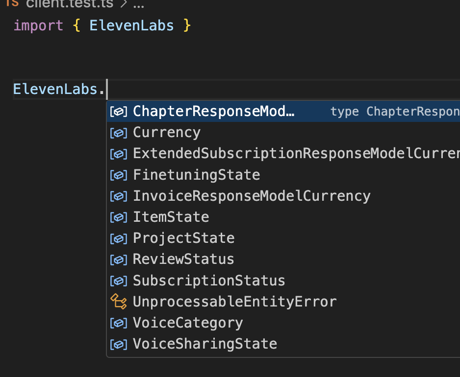

# ElevenLabs JS Library


[](https://buildwithfern.com/?utm_source=fern-elevenlabs/elevenlabs-python/readme)
[](https://discord.gg/elevenlabs)
[](https://twitter.com/elevenlabsio)
[](https://www.npmjs.com/package/@elevenlabs/elevenlabs-js)

> **Note:** This is the Node.js library for ElevenLabs. For the browser SDK, visit [`@elevenlabs/client`](https://www.npmjs.com/package/@elevenlabs/client). For the React SDK, check out [`@elevenlabs/react`](https://www.npmjs.com/package/@elevenlabs/react).

The official Node SDK for [ElevenLabs](https://elevenlabs.io/). ElevenLabs brings the most compelling, rich and lifelike voices to creators and developers in just a few lines of code.

## 📖 API & Docs

Check out the [HTTP API documentation](https://elevenlabs.io/docs/api-reference).

## ⚙️ Install

```bash
npm install @elevenlabs/elevenlabs-js
# or
yarn add @elevenlabs/elevenlabs-js
```

### Main Models

1. **Eleven Multilingual v2** (`eleven_multilingual_v2`)
    - Excels in stability, language diversity, and accent accuracy
    - Supports 29 languages
    - Recommended for most use cases

2. **Eleven Flash v2.5** (`eleven_flash_v2_5`)
    - Ultra-low latency
    - Supports 32 languages
    - Faster model, 50% lower price per character

3. **Eleven Turbo v2.5** (`eleven_turbo_v2_5`)
    - Good balance of quality and latency
    - Ideal for developer use cases where speed is crucial
    - Supports 32 languages

For more detailed information about these models and others, visit the [ElevenLabs Models documentation](https://elevenlabs.io/docs/models).

```ts
import { ElevenLabsClient, play } from "@elevenlabs/elevenlabs-js";

const elevenlabs = new ElevenLabsClient({
    apiKey: "YOUR_API_KEY", // Defaults to process.env.ELEVENLABS_API_KEY
});

const audio = await elevenlabs.textToSpeech.convert("Xb7hH8MSUJpSbSDYk0k2", {
    text: "Hello! 你好! Hola! नमस्ते! Bonjour! こんにちは! مرحبا! 안녕하세요! Ciao! Cześć! Привіт! வணக்கம்!",
    modelId: "eleven_multilingual_v2",
});

await play(audio);
```

<details> <summary> Play </summary>

<i> Don't forget to unmute the player! </i>

[audio (3).webm](https://github.com/elevenlabs/elevenlabs-python/assets/12028621/778fd3ed-0a3a-4d66-8f73-faee099dfdd6)

</details>

⚠️ elevenlabs-js requires [MPV](https://mpv.io/) and [ffmpeg](https://ffmpeg.org/) to play audio.

## 🗣️ Voices

List all your available voices with `search()`.

```ts
import { ElevenLabsClient } from "@elevenlabs/elevenlabs-js";

const elevenlabs = new ElevenLabsClient({
    apiKey: "YOUR_API_KEY", // Defaults to process.env.ELEVENLABS_API_KEY
});

const voices = await elevenlabs.voices.search();
```

For information about the structure of the voices output, please refer to the [official ElevenLabs API documentation for Get Voices](https://elevenlabs.io/docs/api-reference/get-voices).

## 🚿 Streaming

Stream audio in real-time, as it's being generated.

```ts
const audioStream = await elevenlabs.textToSpeech.stream("JBFqnCBsd6RMkjVDRZzb", {
    text: "This is a... streaming voice",
    modelId: "eleven_multilingual_v2",
});

stream(audioStream);
```

## Speech Engine

Speech Engine lets you build voice-powered AI agents with a custom LLM or add voice to your existing chat agent. The ElevenLabs API connects to your server via WebSocket — each connection represents one conversation. You provide the LLM responses, ElevenLabs handles the speech.

There are two ways to set up a Speech Engine server:

### Attach to an existing HTTP server

Use this when you already have a web server (Express, Next.js, Fastify, etc.) and want to handle Speech Engine connections on a specific path alongside your existing routes. Configure your speech engine's server URL to point to the path you choose, e.g. `https://myapp.com/api/speech-engine/ws`.

```ts
import { ElevenLabsClient } from "@elevenlabs/elevenlabs-js";
import OpenAI from "openai";

const elevenlabs = new ElevenLabsClient({
    apiKey: process.env.ELEVENLABS_API_KEY,
});
const openai = new OpenAI({
    apiKey: process.env.OPENAI_API_KEY,
});

// Attach Speech Engine to existing server
await elevenlabs.speechEngine.attach("seng_123", httpServer, "/api/speech-engine/ws", {
    debug: true,

    onInit(conversationId) {
        console.log("session started:", conversationId);
    },

    async onTranscript(transcript, signal, session) {
        // Pass the transcript to your LLM — signal auto-aborts if the user interrupts
        const response = await openai.responses.create(
            {
                model: "gpt-4o",
                instructions: "You are a helpful agent that assists developers in testing SDKs. Help users explore SDK features, debug integration issues, and validate that SDK methods work as expected.",
                input: transcript.map((m) => ({ role: m.role === "agent" ? "assistant" : m.role, content: m.content })),
                stream: true,
            },
            { signal },
        );

        // Stream the LLM response directly — the SDK extracts text from
        // OpenAI, Anthropic, and Gemini stream formats automatically
        session.sendResponse(response);
    },

    onClose(session) {
        console.log("session ended:", session.conversationId);
    },

    onDisconnect(session) {
        console.log("session disconnected:", session.conversationId);
    },

    onError(err) {
        console.error("error:", err);
    },
});
```

### Standalone server

Use this when you want a dedicated server just for Speech Engine — no existing HTTP server needed. It starts a WebSocket server on the given port and every connection is treated as a speech engine session. Configure your speech engine's server URL to point to the host and port directly, e.g. `wss://myserver.com:3001`.

```ts
import { SpeechEngine } from "@elevenlabs/elevenlabs-js";

const server = new SpeechEngine.Server({
    port: 3001,
    engineId: "seng_123",
    apiKey: process.env.ELEVENLABS_API_KEY,
    async onTranscript(transcript, signal, session) {
        const reply = await generateLLMResponse(transcript, { signal });
        session.sendResponse(reply);
    },
});

server.start();
```

Both `SpeechEngine.Server` and `speechEngine.attach()` automatically verify the `X-Elevenlabs-Speech-Engine-Authorization` header on every incoming connection, rejecting any requests that were not signed by ElevenLabs. The API key is read from `apiKey` in the options or the `ELEVENLABS_API_KEY` environment variable.

#### Disabling authentication

If you're running behind an infrastructure layer that already restricts incoming traffic to ElevenLabs (typically an IP allowlist scoped to [ElevenLabs' egress ranges](https://elevenlabs.io/docs/overview/capabilities/speech-engine#ip-allowlisting)), you can skip JWT verification by passing `disableAuth: true`:

```ts
// Standalone — no apiKey required when disableAuth is true
new SpeechEngine.Server({ port: 3001, disableAuth: true, onTranscript }).start();

// Or on attach
elevenlabs.speechEngine.attach("seng_123", httpServer, "/api/speech-engine/ws", {
    disableAuth: true,
    onTranscript,
});
```

When auth is disabled the server accepts any client that can reach it and logs a `console.warn` on startup. **Only use this if you have an IP allowlist or equivalent network-level restriction in front of the server** — without one, anyone on the internet can open a session and consume your compute and downstream LLM quota.

### Session events

| Event | Method | Description |
|---|---|---|
| `user_transcript` | `onTranscript` | User speech transcribed — includes full conversation history and an abort signal |
| `init` | `onInit` | Session initialized with a conversation ID |
| `close` | `onClose` | Clean disconnect from ElevenLabs |
| `disconnected` | `onDisconnect` | WebSocket dropped unexpectedly |
| `error` | `onError` | Protocol or WebSocket error |

## Agent workflows as code

Build an agent [workflow](https://elevenlabs.io/docs/eleven-agents/customization/agent-workflows) with chained methods instead of a hand-written graph of nodes and edges. The `Workflow` object stands for the start node. Each verb adds a node and returns it, so flows read top to bottom:

| Verb | Adds |
|---|---|
| `converse(id, prompt, options?)` | The agent holds a conversation with `prompt` added to its instructions (a subagent node) |
| `tool(id, toolIds, options?)` | A node that runs tools; route on the result with `onResult()`, or `onSuccess()` / `onFailure()` |
| `transfer(id, destination, options?)` | A transfer to a phone number, SIP URI or another agent |
| `end(options?)` | The end of the conversation (shared `"end"` node unless you pass an `id`) |

`when(condition)` opens a conditional branch. A string is an LLM condition; an `Expr` is an expression over dynamic variables. `goTo(node)` moves the conversation to a node that already exists, for merges and loops. The API allows one edge between any two nodes, so going back to a node that already leads here is sent as that edge's backward condition; any other second edge between the same two nodes fails `build()`.

`up()` returns the node the current one was chained from, so you can write a whole workflow as one chain:

```typescript
wf.converse("triage", "Greet the caller and find out why they're calling")
    .when("Caller wants a human").transfer("human", Destination.phone("+15551234567")).up()
    .when("Caller is done").end();
```

```typescript
import { ElevenLabsClient, Workflow, Destination, Expr } from "@elevenlabs/elevenlabs-js";

const wf = new Workflow();

const triage = wf.converse("triage", "Greet the caller and find out why they're calling");
const identify = triage.when("Caller wants to check an order").converse("identify", "Ask for the order number");

const lookup = identify.when("Caller gave an order number").tool("lookup_order", ["tool_get_order"]);
lookup.onResult({
    success: (ok) => ok.converse("resolve", "Explain the order status").when("Caller is satisfied").end(),
    failure: (failed) => failed.goTo(identify),
});

triage.when(Expr.variable("tier").eq("gold")).transfer("vip", Destination.agent("agent_vip"));
triage.when("Caller wants a human").transfer("human", Destination.phone("+15551234567"));

const client = new ElevenLabsClient();
await client.conversationalAi.agents.update("agent_id", { workflow: wf.build() });
```

`build()` checks the whole graph and throws one `WorkflowValidationError` that lists every problem it finds. It also generates edge ids and edge order, and lays out nodes that don't have a position, so they don't all stack on top of each other in the editor.

### Editing an existing agent

```typescript
const agent = await client.conversationalAi.agents.get("agent_id");
const wf = Workflow.fromAgent(agent); // keeps node ids, editor positions and edge order

wf.node("resolve").update({ prompt: "Explain the status, then offer a discount code" });
const verify = wf.insertBetween("identify", "lookup_order", (from) => from.converse("verify", "Verify the caller's identity"));
verify?.when("Caller can't verify").end({ id: "unverified" }); // returns the inserted node, or undefined if there's no such edge
wf.remove("vip");

await client.conversationalAi.agents.update("agent_id", { workflow: wf.build() });
```

### Storing workflows in git

`toJSONString()` writes the workflow in API format: snake_case keys, sorted, the same shape the REST API and the ElevenLabs CLI use. `Workflow.fromJSON()` reads it back. It also accepts a full agent config file that has a `workflow` key.

```typescript
import { readFile, writeFile } from "node:fs/promises";

await writeFile("workflows/support.json", wf.toJSONString());
const stored = Workflow.fromJSON(await readFile("workflows/support.json", "utf8"));
```

A workflow loaded from the API or a file can contain node types that are newer than your SDK version. They round-trip through `fromJSON()` and `toJSONString()` unchanged, but `agents.update()` rejects them, and `build()` warns about each one. Upgrade the SDK, or send the wire format directly:

```typescript
await client.conversationalAi.agents.update("agent_id", {}, { additionalBodyParameters: { workflow: wf.toJSON() } });
```

## Agent tools as code

Define webhook, client and system tools with chained methods instead of nested JSON schemas. `build()` returns the request `tools.create()` and `tools.update()` accept, and `toJSONString()` writes the same file the ElevenLabs CLI keeps in `tool_configs/`:

```typescript
import { ElevenLabsClient, Tool, SystemTool, Schema, Header, Destination } from "@elevenlabs/elevenlabs-js";

const refund = Tool.webhook("issue_refund", "Refund an order the caller asked to return")
    .post("https://api.example.com/orders/{order_id}/refunds")
    .pathParam("order_id", Schema.string().describe("The order number, e.g. A-1042"))
    .header("Authorization", Header.secret("sec_orders_api"))
    .body(
        Schema.object()
            .property("customer_id", Schema.string().fromVariable("customer_id"))
            .property("reason", Schema.string().describe("Why the caller wants a refund").choices(["damaged", "late", "other"]))
            .property("note", Schema.string().describe("Anything else the caller said").optional()),
    )
    .assign("refund_id", "refund.id");

const client = new ElevenLabsClient();
await client.conversationalAi.tools.create(refund.build());

const transfer = SystemTool.transferToNumber()
    .transfer("Caller asks for billing", Destination.phone("+15551234567"));
```

Each schema property gets its value from exactly one place: the LLM (`describe()`), a dynamic variable (`fromVariable()`), a `constant()`, the system (`systemProvided()`), or nowhere (`omit()`). Properties are required unless you call `optional()`. Schemas are values, so you can reuse one across tools.

`build()` checks the whole tool first and throws a `ToolValidationError` listing every problem. For example, it reports a `{placeholder}` in the URL with no matching `pathParam()`, a property with two value sources, or a `GET` with a body. Load an existing tool with `Tool.fromResponse(await client.conversationalAi.tools.get(toolId))` or `Tool.fromJSON(file)`, edit it, and push it back with `tools.update()`.

## Retries

This Node SDK is instrumented with automatic retries with exponential backoff. A request will be
retried as long as the request is deemed retry-able and the number of retry attempts has not grown larger
than the configured retry limit (default: 2).

A request is deemed able to retry when any of the following HTTP status codes is returned:

- [408](https://developer.mozilla.org/en-US/docs/Web/HTTP/Status/408) (Timeout)
- [409](https://developer.mozilla.org/en-US/docs/Web/HTTP/Status/409) (Conflict)
- [429](https://developer.mozilla.org/en-US/docs/Web/HTTP/Status/429) (Too Many Requests)
- [5XX](https://developer.mozilla.org/en-US/docs/Web/HTTP/Status/500) (Internal Server Errors)

Use the `maxRetries` request option to configure this behavior.

```ts
const response = await elevenlabs.voices.search(
    {},
    {
        maxRetries: 2, // Set the maximum number of retries
    },
);
```

## Timeouts

The SDK defaults to a 60 second timeout. Use the `timeoutInSeconds` option to
configure this behavior.

```ts
const response = await elevenlabs.voices.search(
    {},
    {
        timeoutInSeconds: 30, // override timeout to 30s
    },
);
```

## Runtime compatibility

The SDK defaults to `node-fetch` but will use the global fetch client if present. The SDK
works in the following runtimes:

The following runtimes are supported:

- Node.js 15+
- Vercel
- Cloudflare Workers
- Deno v1.25+
- Bun 1.0+

## Elevenlabs Namespace

All of the ElevenLabs models are nested within the `ElevenLabs` namespace.



## Languages Supported

Explore [all models & languages](https://elevenlabs.io/docs/models).

## Contributing

While we value open-source contributions to this SDK, this library is generated programmatically. Additions made directly to this library would have to be moved over to our generation code, otherwise they would be overwritten upon the next generated release. Feel free to open a PR as a proof of concept, but know that we will not be able to merge it as-is. We suggest opening an issue first to discuss with us!

On the other hand, contributions to the README are always very welcome!
